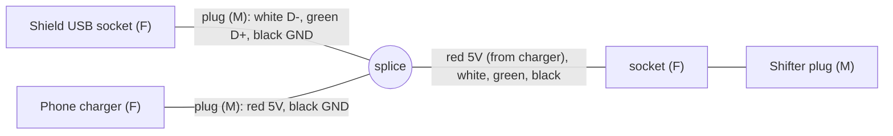

# USB Shifter to Thrustmaster Wheelbase
Use a Generic USB Shifter to connect to a Thrustmaster wheelbase, Emulating a TH8A shifter which will work on console!
This allows for compatibility with wheelbase while also retaining PC plug and play functionality with the USB Shiel method or if you want a more permanent solution try the hardwire option

Might work on other wheelbases but have only tested it on a T300 RS GT + PS4 (GT7)

IRTV Forums suggest it will also work on TMX wheelbase. It might work on any wheelbase that uses the TH8A Mini-Din (PS2) port
(had a report of TS-XW wheelbase not playing nice? Let me know how you go)

## Pre-requisuite Knowledge
* You will need to know how to solder wires
* Flash Arduino with TTL Adaptor
* Know how to import a libary into Arduino IDE
* Comment/uncomment code and read from serial monitor in Arduino IDE

## Hardwire or USB Shield?
Clicking the link will take you to the instructions page showing you whats required, how to 
### [Hardwire](ShifterDirectWire.md)
This method involves opening up the shifter and identifying the pins and corresponding microswitches so we can directly wire them to the arduino.
This is a more permanent solution and you will lose the USB functionality due to having to remove the USB microcontroller in the shifter to easily access the pins. It is possible to retain both in the shifter with a bit of fiddling and work, but I won't be going through that in this guide.
### [USB Shield](USBShield.md)
This allows for compatibility with the wheelbase while also retaining PC USB plug and play functionality. (as it retains USB cable that can be unplugged from shield)
This is more of a 'plug and play' solution as nothing is permanently attached or removed. Unfortunately I have gotten a report thus far that it hasn't worked for them (more info in discussions and in the documentation) so your mileage may vary. USB shifters are not all made the same way, which can introduce variables. I have had success with this method however on my 6+R+switch Shifter. So, let me know how you go with this method should you try it.

> **Shifter connects but never reports a gear?** Read [Build notes & troubleshooting](#build-notes--troubleshooting-hall-effect-6r-shifter-t300-ps5) below. It covers a USB quirk of some DragonRise-based shifters, plus a long list of flashing and power problems and how they were solved.

## Print or Cut your own Shifter Top Plates!
I have also made up faceplates that closely match the original top plates!
These come in 6+R, 7+R and switch versions that can be both 3d printed or laser cut (dxf files)

You can find more details and downloads to these below
* Thingiverse - https://www.thingiverse.com/thing:6157415
* Printables - https://www.printables.com/model/545213-usb-shifter-top-plate


And the original Onshape sketch here

https://cad.onshape.com/documents/a3d9d44c33b1132797555d44/w/ee8f103d1e1c9a353ae6a04f/e/e706485c28816b59edb06570?renderMode=0&uiState=64cf4ada2f1e726c453e6d22

## Disclaimer
Look, this is really hastily put together. I really wasnt happy with the lack of documentation for my dumb brain to comprehend so I used a Shield example that got me 90% of the way there and then piggy backed off that.

I'm 100% sure there is a better way of doing this that is cleaner but it does indeed work. Happy for anyone to provide suggestions, improvements and such!

Included is a reference folder for additional stuff downloaded from ISRTV.com. The information and .ino files are way too valuable to not have a backup somewhere...

Thanks to the people at ISRTV.com that did the heavy lifting. Their code was enough for me to adapt it here. Not ideal, but 

## Build notes & troubleshooting (hall effect 6+R shifter, T300, PS5)
These notes come from a second build of the **USB Shield** method. It used a **hall effect 6+R USB shifter**, a **T300 RS** base and a **PS5** (GT7), and it now works. Almost everything that could go wrong did, so here is every problem and its fix. Most of them apply to any build.

### What the finished setup looks like

The wheelbase is the **only** power source. The shield passes its 3.3V on to the shifter's USB port.

### Quick reference: the changes in this version of the sketch
| Change in [USBShifter2PS2.ino](USBShifter2PS2/USBShifter2PS2.ino) | Why |
|---|---|
| `ShifterHID` class reads the HID **report descriptor** after the shifter attaches | Some shifters send **nothing** until this happens (see [Quirk 1](#quirk-1-shifter-connects-but-never-sends-data)) |
| The TH8A frame is sent to the base **every 10 ms**, not only on gear change | Matches the ISRTV reference sketches and a real TH8A, and the first frame after power-up is no longer lost |
| `Wire.setWireTimeout(3000, true)` | A stuck I2C bus can never freeze the loop |
| Gear codes for the hall effect 6+R shifter | That shifter's button order differs from the original (see [gear codes](#gear-codes-and-how-to-find-yours)) |
| `#define DEBUG_RAW` (commented out by default) | Turns on detailed diagnostics. Leave it off for normal use, because it adds a few milliseconds of serial printing per shift. |

---

### Pinout: double-checked
The pinout in [USBShield.md](USBShield.md) is correct. Things that caused doubt:

* **Pin 3 "/Shifter ON" really goes to GND.** The `/` means *active low*. Grounding it is how the base knows a shifter is plugged in.
* **PS/2 extension cables have no standard colour code.** Check every wire with a multimeter in continuity mode. Number the pins with the **plug face toward you, key on top**:
  ```
      5  [key]  6
    3             4
      1         2        (plug, viewed from the pins / front)
  ```
* **A4 and A5 on Pro Mini clones** are the two pins **in the middle of the board**, next to the chip. On many clones, the black plastic of a soldered header hides their labels. Check before soldering: A4 is the one nearer A2, and A5 is the one nearer VCC.
* **Check that your Pro Mini really is the 3.3V / 8 MHz version.** The crystal should read `8.000`. Upload with `--fqbn arduino:avr:pro:cpu=8MHzatmega328`.

### Flashing problems
#### Problem: `avrdude: stk500_getsync() ... not in sync: resp=0x00` and a low VCC (2.8–3.0V)
In this build, the cause was **one broken Dupont jumper on GND**. Without a ground wire, the Pro Mini still half-powers itself through the protection diodes on its TX/RX/DTR pins. You get a slightly low VCC and a lit LED, but serial communication doesn't work at all. Hours went into fuse/bootloader theories before this was found.

* **Check every jumper end to end with a multimeter in continuity mode before flashing.** Cheap Dupont wires fail more often than you'd think.
* Another hint: if the board's power LED stays lit while the GND wire is missing, it's back-powering.

#### Problem: the FT232's 3.3V output can't power the Pro Mini and the shield
In 3.3V mode, most FT232RL boards take VCC from the **FT232 chip's internal regulator, which supplies only about 50 mA**. The MAX3421E on the shield alone draws about 45 mA, so VCC sags and the board browns out during reset.
**Fix: flash the Pro Mini *off* the shield.** It's only plugged into the shield's female headers, so pull it off for flashing and push it back on afterwards.

#### Problem: FT232 clone boards ("FT232-AZ" and similar)
The AZ-Delivery USB-C "FT232RL" board used here has a chip marked **`FT232-AZ`**, not a genuine FTDI FT232RL. Differences seen:

| Issue | Detail |
|---|---|
| **Fragile 3.3V output** | It died after a brief accidental short with a multimeter probe. VCC then read about 0.1–0.3V in 3.3V mode, but the 5V position still worked. USB and serial still work in 5V mode. |
| **No synchronous bit-bang** | Using it as an ISP programmer (`avrdude -c arduino-ft232r`, after swapping the driver with Zadig) **hangs forever**, with both the Arduino-bundled avrdude 8.0 and avrdude 8.3. Clone chips don't implement that mode properly. |
| **DTR auto-reset may not work** | A tidy board still uploads, but don't rely on DTR on a clone. |
| **Driver** | Device Manager may show *USB Serial Port, error code 28*. Install FTDI's **VCP driver**, or let Windows Update fetch it. |

If you tried Zadig and want the COM port back: Device Manager → *Universal Serial Bus devices* → **FT232R USB UART** → *Uninstall device*, tick **"Attempt to remove the driver"**, then replug.

If you ever need ISP programming without a working bit-bang mode: `avrdude`'s **`serbb`** type uses only the modem control lines through the normal COM driver, so it works on clones. On a TTL adapter all lines are inverted. This definition was used, with RTS→RST, DTR→D13, TX→D11, CTS→D12:
```
programmer
    id = "ftdittl"; desc = "FT232 TTL serbb (inverted)";
    type = "serbb"; prog_modes = PM_ISP; connection_type = serial;
    reset = ~7; sck = ~4; sdo = ~3; sdi = ~8;
;
```
In the end it wasn't needed: the bootloader was fine all along, and the bad GND jumper was the real problem.

#### Flashing with a 5V-only adapter (or one whose 3.3V died)
The ATmega328P on the "3.3V" Pro Mini is the **same chip** as on the 5V version, rated **1.8–5.5V**. "3.3V version" only describes the regulator and the 8 MHz crystal. So the **bare** Pro Mini can be flashed at 5V safely, and all signals then match the adapter's 5V logic, with no level shifting needed. Wiring, with the adapter's jumper on **5V**:

| Pro Mini (6-pin header) | → | FT232 (6-pin header) |
|---|---|---|
| DTR | → | DTR |
| TXO | → | RX |
| RXI | → | TX |
| VCC | → | VCC (5V) |
| GND | → | GND (tested jumper!) |
| spare GND | | CTS: leave empty |

> ⚠️ **Rules for 5V flashing**
> 1. **The Pro Mini must be OFF the USB shield.** The MAX3421E only tolerates 3.3V.
> 2. **The PS/2 plug must be OUT of the wheelbase.** The Pro Mini's I2C pull-ups and its VCC (see the power section below) would push 5V into the base.
> 3. Afterwards, remove the jumpers before putting the Pro Mini back on the shield.

If you'd rather keep the Pro Mini at 3.3V with a 5V adapter: power it through **RAW** (its regulator makes 3.3V), and put a **1–10 kΩ resistor** in the adapter TX → Pro Mini RXI line. TXO → RX and DTR can go direct.

#### Reading debug output on the wheel (any adapter)
To watch the serial monitor while the base powers everything, connect **only two wires**: Pro Mini **TXO → adapter RX** and **GND → GND**. Never connect the adapter's VCC. This is safe in 5V mode too: RX is an input, so no power can flow into the base.

* **Plug the adapter into the PC *before* the wheel is switched on.** Otherwise the Pro Mini's TXO back-powers the unpowered adapter, its LEDs glow, and Windows then fails with *"USB device not recognized / Device Descriptor Request Failed"*. If that happens: unplug the adapter, pull the TXO jumper, plug the adapter in, then put TXO back.
* Leave the adapter's jumper on 5V if its 3.3V side is dead. Its I/O pins are powered by whichever voltage the jumper selects.

### Power problems
#### VCC only 2.9V when powered from the base
The wiring in [USBShield.md](USBShield.md) feeds the base's 3.3V (PS/2 pin 5) into **RAW**. The Pro Mini's regulator then drops it to about **2.9V** under load, at the bottom of the MAX3421E's range (3.0–3.6V). **Fix:** solder the pin-5 wire to **VCC** instead, which bypasses the regulator. It's easiest on the **shield's VCC pin**, the header pin under the Pro Mini's VCC. Check with continuity: shield pin ↔ Pro Mini VCC beeps, and ↔ GND doesn't. Result: about **3.2V** under load.

Bonus: with the wire on the shield, the Pro Mini can be pulled off for flashing without the PS/2 cable being connected to its VCC.

#### Does the shifter need 5V?
The shield's USB socket gives the shifter only the 3.3V rail. **VBUS measured 3.32V with no load**, about two-thirds of what USB normally supplies. **This hall effect shifter works fine at that voltage.** The real problem turned out to be [Quirk 1](#quirk-1-shifter-connects-but-never-sends-data). If your shifter doesn't work at 3.3V, here is a **non-destructive** way to give it a real 5V: a **split-power USB cable**. The shifter's power comes from a phone charger, while data and GND still go through the shield.



| Wire | Cable to the shield (M) | Cable to the charger (M) | Cable to the shifter (F) |
|---|---|---|---|
| **red** (5V) | **insulate, unused** | → joined → | red |
| **black** (GND) | joined | joined | joined (all three together) |
| **white** (D−) | → joined → | insulate | white |
| **green** (D+) | → joined → | insulate | green |

Checks before plugging in: at the shifter socket, red to black is about **5V**. At the plug going into the shield, red to black is **0V**, which proves the 5V can't reach the 3.3V shield. Plug the charger in last.

The permanent alternative is a small **3.3V→5V boost converter** (Pololu U1V11F5 or MT3608 set to 5.0V) feeding the shield's VBUS pad. That needs the **VBUS trace on the shield cut** first, so the 5V never reaches the 3.3V rail. Keep in mind it draws more current from the base.

### Quirk 1: shifter connects but never sends data
**Symptom:** the shifter works on a PC. On the shield, the USB connection succeeds (state `0x90`, `HID ready 1`), but **no report ever arrives**. In debug mode, every interrupt poll returns **NAK** (about 100 per second, 0 errors), even while shifting.

**Cause:** this shifter (VID `0x0079`, PID `0x0006`, "Generic USB Joystick", a DragonRise chip) doesn't start sending reports until the host has requested its **HID report descriptor**. Windows always does that on connect. The USB Host Shield library's `HIDUniversal` doesn't.

**Fix:** it's in the sketch already. A small `HIDUniversal` subclass does it in `OnInitSuccessful()`:
```cpp
class ShifterHID : public HIDUniversal {
public:
  ShifterHID(USB *p) : HIDUniversal(p) {}
protected:
  uint8_t OnInitSuccessful() override {
    uint8_t buf[64];
    pUsb->ctrlReq(bAddress, 0, bmREQ_HID_REPORT, USB_REQUEST_GET_DESCRIPTOR, 0x00,
                  HID_DESCRIPTOR_REPORT, 0x0000, sizeof(buf), sizeof(buf), buf, NULL);
    return 0;
  }
};
ShifterHID Hid(&Usb);
```
Also note: this shifter answers `GET_REPORT` with a **STALL**, so polling it actively doesn't work. You have to wait for interrupt reports.

### Gear codes and how to find yours
Different shifters (even ones with the same chip) assign buttons differently. Each gear is one HID button, and the sketch's `evt->y` value is:
```
y = 15 + 16 × 2^(button − 1)        (15 = neutral, nothing pressed)
```

| Gear | Original 6+R+switch (azzajess) | Hall effect 6+R (this build) |
|---|---|---|
| N | 15 | 15 |
| 1 | 31 (button 1) | **79** (button 3) |
| 2 | 47 | **143** |
| 3 | 79 | **271** |
| 4 | 143 | **527** |
| 5 | 271 | **1039** |
| 6 | 527 | **2063** (button 8) |
| R | 2063 | **31** (button 1) |

**Easiest way to find your codes:** plug the shifter into a **PC** and open `joy.cpl` (Win+R) → *Properties*. Note which button number lights up in each gear, then apply the formula. Alternatively, enable `DEBUG_RAW` and read the `y=` lines in the serial monitor.

### Testing: you can't verify gears on a PC
With the T300 connected to a PC, it reports only **13 buttons** to Windows, so the gears of a shifter plugged into its PS/2 port **never show up** in `joy.cpl` or in games on PC. That's true even when everything works. Test on the console instead:

1. Set the base's mode switch to **PS4** (the PS5 uses PS4 mode).
2. After switching the wheel on, **press the PS button**. Wheel and shifter only initialise after that. If you forget, it looks like "the shifter is not recognised".
3. In GT7, set the transmission to **manual**.

What you *can* check on a PC with `DEBUG_RAW`: the line `I2C ok=… fail=0` means the base **acknowledges** every TH8A frame. That confirms the wiring (A4/A5, pin 3 GND) and the address are right.

### Debug mode (`#define DEBUG_RAW`)
Uncomment `#define DEBUG_RAW` near the top of the sketch to get:

| Output | Meaning |
|---|---|
| `USB state 0x12` | waiting for a USB device |
| `USB state 0x20 … 0x90` | device found → reset → configured; `0x90` = running |
| `HID ready 1` + VID/PID/endpoint dump | the HID driver attached to the shifter |
| `ConfDescr …` / `ReportDescr …` | raw USB descriptors of the shifter |
| `RAW len=8: …` and `y=…` | a report from the shifter, plus the value the gear mapping uses |
| `Gear N` | the gear sent to the base (8 = reverse) |
| `Poll NAK=… err=…` | every 2 s: interrupt poll results. Lots of NAK and no reports means [Quirk 1](#quirk-1-shifter-connects-but-never-sends-data). Errors mean a USB link problem. |
| `I2C ok=… fail=… lastErr=…` | every 2 s: TH8A frames acknowledged by the base. `fail` with `lastErr=2` means the base isn't answering. |
| `*W??5` at power-up | garbled text from a reset or brown-out, for example when hot-plugging the shifter. Harmless. |

### Everyday use & safety summary
* **Normal use:** shifter in the shield, Pro Mini on the shield, PS/2 into the base. Nothing else.
* **Hot-plugging the PS/2** into a running base worked in this build. The plug's metal shell, which is grounded, makes contact first. Still, push it in straight. Unplugging is always harmless.
* **Hot-plugging the shifter's USB** makes the Pro Mini reboot (brown-out). It's harmless, and it reconnects by itself within a few seconds.
* **Never** connect a programmer's VCC to the Pro Mini while the PS/2 plug is in the wheelbase.
* **Never** put 5V on the Pro Mini while it's on the shield.

## Resources/Research
* USB Hosts Shield - https://chome.nerpa.tech/usb-host-shield-hardware-manual/
* USB Host Shield github info + examples - https://github.com/felis/USB_Host_Shield_2.0/
* Alot of the USB Shield Host code came from this example ino - https://github.com/felis/USB_Host_Shield_2.0/blob/master/examples/HID/t16km/t16km.ino#L55
* ISRTV forum where a lot of the info was from - https://www.isrtv.com/forums/topic/24532-gearbox-connector-on-base/
